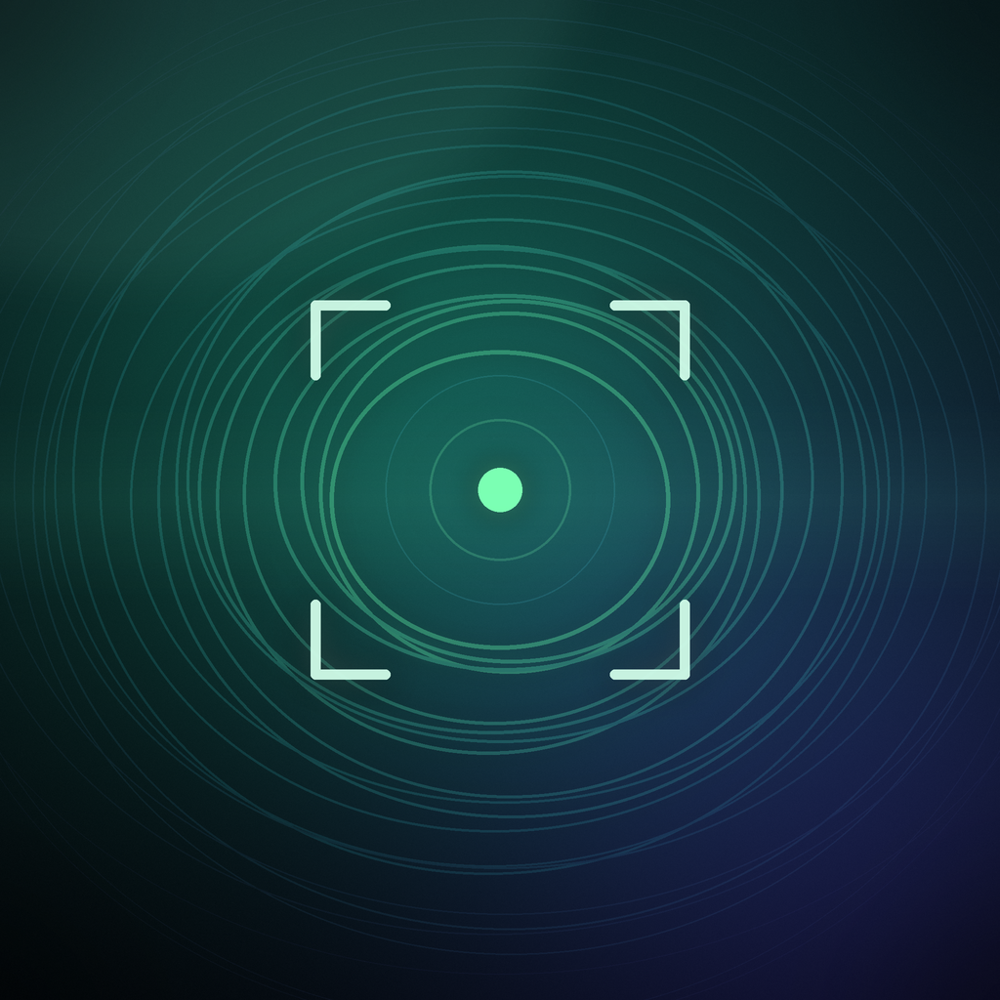

# LiDAR Camera

A depth-only iOS camera. It checks for LiDAR hardware **before** the home screen ever appears, and it never displays, records, or stores the normal RGB camera feed.



## Requirements

- Xcode 16 or newer (the project uses Xcode 16 synchronized groups)
- iOS 17.0+
- A physical LiDAR device: iPhone 12 Pro / Pro Max or any newer Pro model
- The Simulator intentionally shows the unsupported screen

## Run it

1. Open `LiDARCamera.xcodeproj`.
2. Select the `LiDARCamera` target → **Signing & Capabilities**.
3. Choose your Team and change the bundle identifier from `com.example.lidarcamera` if needed.
4. Select a physical LiDAR iPhone and run.

The app refuses to continue on hardware without LiDAR. There is no RGB fallback and no way to skip the check.

## The startup gate

`RootView` launches into the hardware check, not the home screen:

```swift
let world = ARWorldTrackingConfiguration.isSupported
let sceneDepth = ARWorldTrackingConfiguration.supportsFrameSemantics(.sceneDepth)
let smoothedDepth = ARWorldTrackingConfiguration.supportsFrameSemantics(.smoothedSceneDepth)
```

`isSupported` requires world tracking plus scene depth and rejects the Simulator. The home screen is only constructed after this returns true. The scan screen runs the same check again before starting `ARSession`.

## What is captured

Two live visualizations, both generated from ARKit `sceneDepth`:

- **Depth map** — distance rendered as a false-color field with contour lines. No camera image is drawn.
- **Point cloud** — the depth map is unprojected through the camera intrinsics and rendered as Metal points in world space. Drag to look around, pinch to zoom.

Each capture stores, inside the app's Documents folder:

| File | Contents |
| --- | --- |
| `depth.png` | 540×960 colorized depth visualization |
| `thumb.jpg` | library thumbnail |
| `depth.f32` | raw 32-bit float depth at the native LiDAR grid (often 256×192) |
| `cloud.ply` | world-space ASCII point cloud in meters, with palette colors |
| `capture.json` | metadata (range, grid size, mode, palette, point count) |

Exports are shared through the system share sheet. Nothing is uploaded and there is no analytics.

## About camera permission

This is the one unavoidable iOS constraint:

- ARKit powers the LiDAR scanner, and ARKit requires camera permission even when only depth frames are requested.
- The app requests **no** `AVCaptureSession`, no photo library access, and no microphone access.
- It never reads `ARFrame.capturedImage`, never displays a camera preview, and never writes RGB pixels anywhere.
- If camera permission is denied, LiDAR is unavailable. The scan screen explains this and offers a Settings shortcut.

This distinction is stated in the launch check, home screen, scan activation sheet, and the Info sheet.

## Structure

```
LiDARCamera/
├── App/           app entry + startup gate
├── Core/          capability report, models, ARSession engine, capture library
├── Rendering/     Metal view, renderer, depth/point shaders
├── Views/         check, unsupported, home, scan, library, detail
└── Assets.xcassets
```

## Technical notes

- The Metal point renderer draws one vertex per depth pixel from the depth texture, using `camera.intrinsics` and the current camera transform. There is no per-frame CPU point-cloud work; PLY generation happens only on capture.
- ARKit depth maps are read according to their actual pixel format: `kCVPixelFormatType_DepthFloat16` maps to an `.r16Float` Metal texture, and `kCVPixelFormatType_DepthFloat32` maps to `.r32Float`. Metrics and captures use the same format-aware reader.
- The depth map is oriented for portrait using `ARFrame.displayTransform(for:viewportSize:)`.
- The live point cloud is rendered from an orbit camera anchored at the session's starting camera pose.
- The color range is 0.2–5.0 m for readability. The raw file and PLY retain depth values below 10 m.
- The app targets iPhone, portrait only, and forces dark appearance.
- `NSCameraUsageDescription` is set in the generated Info.plist through build settings.

## Automatic IPA builds

`.github/workflows/build-ipa.yml` runs on every push to `main` and can also be
started manually. It builds the app with Xcode on a macOS runner, packages an
IPA, uploads it as a workflow artifact, and attaches it to a GitHub Release.

The release IPA is **unsigned** because GitHub Actions has no Apple signing
certificate or provisioning profile. It can be re-signed with your own Apple
development team using Xcode, Apple Configurator, or a sideloading tool.
